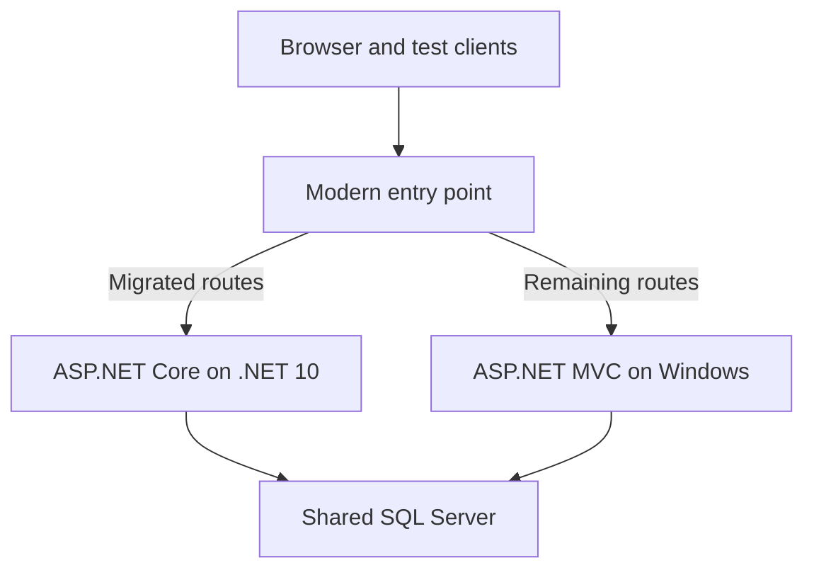
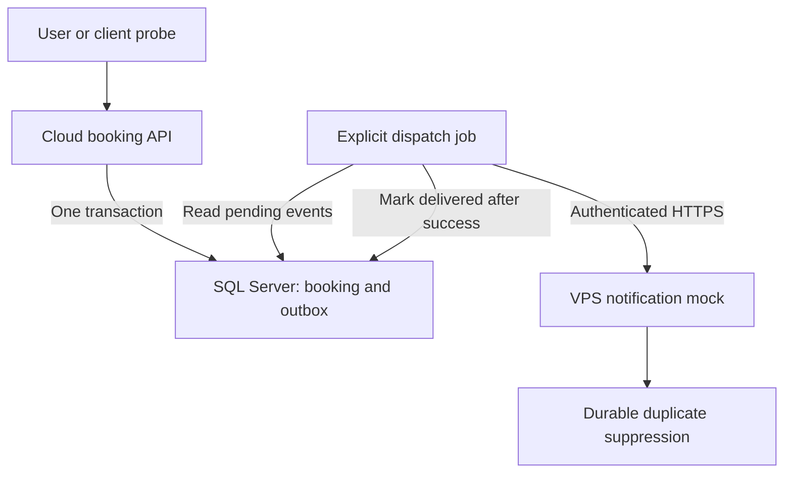
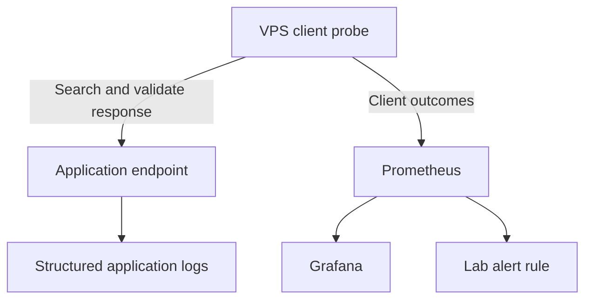

# Architecture views

These diagrams describe the teaching topology. They do not represent KAI's current systems.

## Incremental migration

The supplied adapter supports only the lab API routes. Both implementations share the booking library. Do not combine the SQLite fallback with the Windows migration path, which requires SQL Server.

## Notification isolation

The first release invokes dispatch explicitly. A later scheduled worker automates delivery. Pub/Sub and SQS can be introduced between the publisher and consumer after the basic recovery behavior works.

## Monitoring boundary

A VPS outage also removes its probe and monitoring. Keep cloud-native logs and platform monitoring available independently. Missing probe data is unknown and requires a monitoring-health alert. These synthetic searches do not measure every customer journey.
